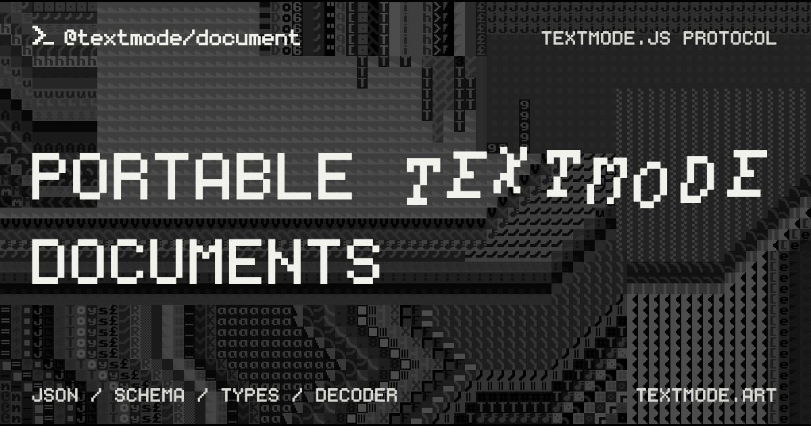

# @textmode/document

<div align="center">



| [](https://www.typescriptlang.org/) [](https://json-schema.org/draft/2020-12) | [](https://code.textmode.art/) [](https://discord.gg/sjrw8QXNks) | [](https://ko-fi.com/V7V8JG2FY) [](https://github.com/sponsors/humanbydefinition) |
| :----------------------------------------------------------------------------------------------------------------------------------------------------------------------------------------------------------------------------------------------------------------------------------------------- | :------------------------------------------------------------------------------------------------------------------------------------------------------------------------------------------------------------------------------------------------------------------------------- | :---------------------------------------------------------------------------------------------------------------------------------------------------------------------------------------------------------------------------------------------------------- |

</div>

`@textmode/document` defines a portable, versioned JSON format for textmode artwork. It provides a language-neutral specification, JSON Schema, TypeScript types, and a dependency-free decoder for browsers and Node.js.

The package defines a unified `textmode.document@4.0.0` structure with complete frame snapshots and reads v3.1, v3.0, v2, plus `textmode.layer@1.0.0` and `textmode.layer@1.1.0`. The package version and document format version are independent. Updating this library does not change existing files.

## Install

Install the published package from npm:

```sh
npm install @textmode/document
```

The JavaScript interface is ESM-only and has no runtime dependencies. It does not require `textmode.js`, a renderer, DOM globals, or media encoders.

## Decode a document

```js
import { parseTextmodeDocumentJSON } from '@textmode/document';

const result = parseTextmodeDocumentJSON(jsonText, {
	limits: { maxCells: 65536, maxLayers: 64 },
});

if (!result.ok) {
	console.error(result.error.code, result.error.path, result.error.message);
} else {
	console.log(result.document.frames.length, result.warnings);
}
```

Successful decoding returns a new canonical document. Colors use RGBA objects, cell rotations use `[0, 360)`, and unknown properties are omitted. Older files become one 100 ms frame. Apply each app's supported-feature policy after decoding.

## Documentation

- [Consumer guide](docs/consumer-guide.md): parsing, schema imports, error handling, resource budgets, and complete examples.
- [Format 4.0 specification](docs/specification-4.0.md): the language-neutral contract for producers and consumers.
- [JSON Schema visual guide](docs/schema-4.0.md): diagrams of frames, layers, cells, and validation responsibilities.
- [V4 migration and release guide](docs/release-4.0.md): consumer requirements and reader-first rollout.
- [Format 2.0 reference](docs/specification-2.0.md) and [visual guide](docs/schema-2.0.md): the older wire format.
- [JSON Schema](schemas/4.0/schema.json): also available from `@textmode/document/schema/4.0`.

The schema identifier is an identifier. It does not promise that the schema is hosted at that URL. Test fixtures are private test data. They are not package exports and are excluded from npm packages.

## Contributing

Thank you for considering a contribution to this project.

Read the [Contributing Guide](./CONTRIBUTING.md) to get started.

## License

`@textmode/document` is dedicated to the public domain under [CC0 1.0 Universal](./LICENSE).
