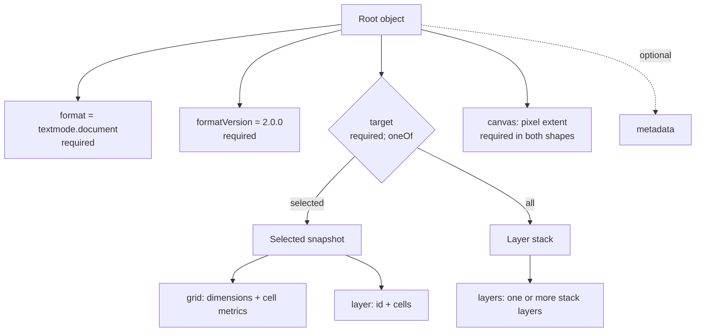
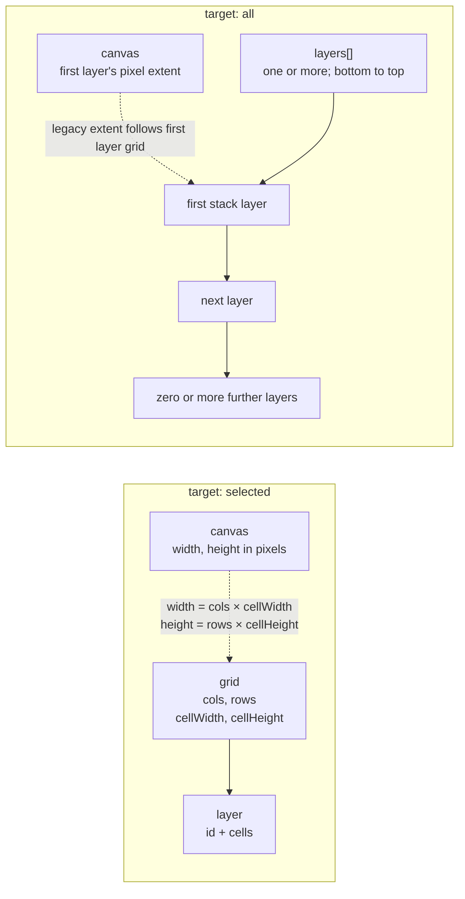
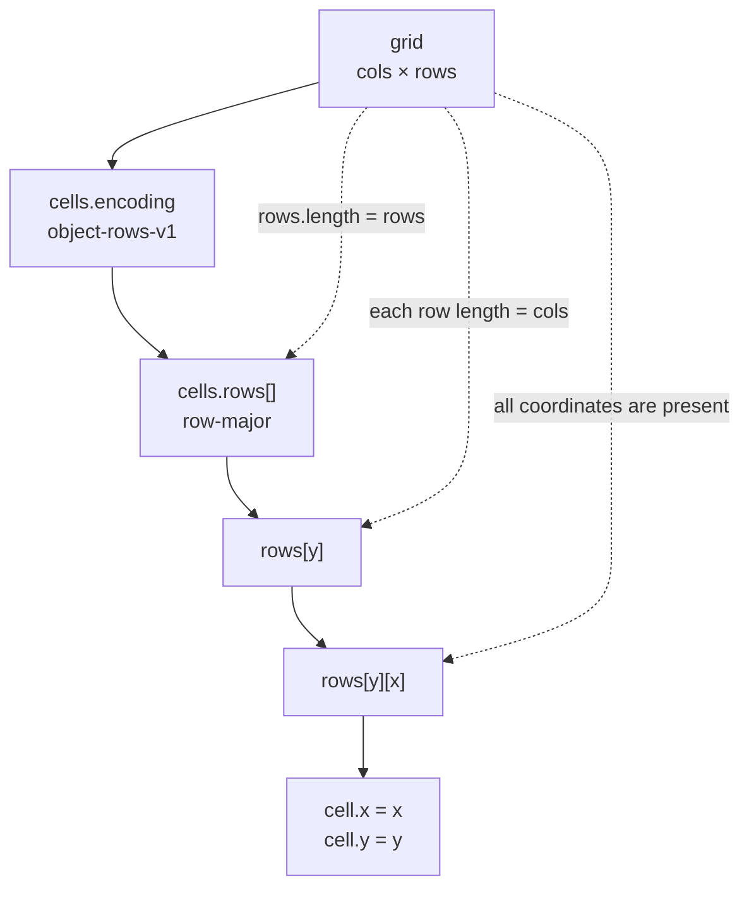
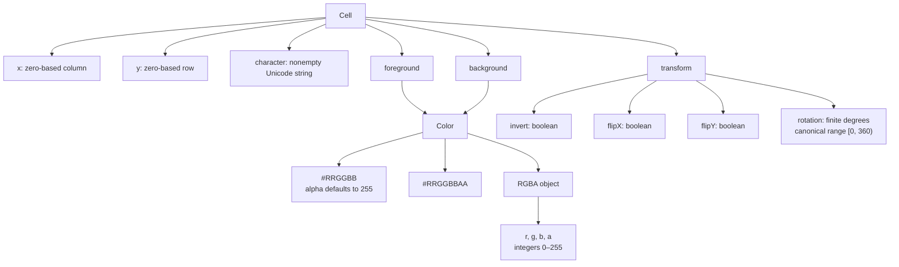
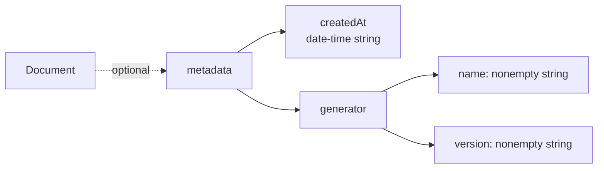
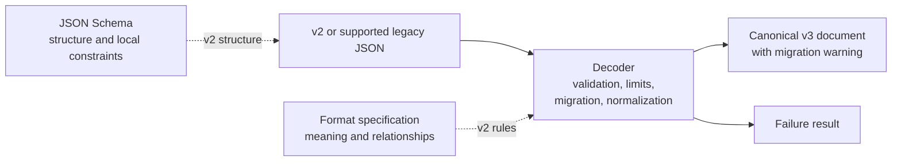

# Visual guide to document format 2.0

This is a historical wire-format reference. The current decoder returns [v4 frames](specification-4.0.md) for every supported input.

> Versioned v2 reference. Historical v3 documentation is in the
> [v3 specification](specification-3.0.md) and [visual guide](schema-3.0.md).
> The current decoder validates these older shapes and migrates them to v4.

These diagrams show the structure of `textmode.document@2.0.0`. For the complete
rules, see the [v2 specification](specification-2.0.md) and [JSON Schema](../schemas/2.0/schema.json).
For decoding examples and error handling, see the [consumer guide](consumer-guide.md).

## Document shapes

A v2 document has one of two shapes. Both include the format, version, and
`canvas` extent; metadata is optional. The `target` field selects the shape.

### Root fields

| Field           | Required      | Meaning                                                                              |
| --------------- | ------------- | ------------------------------------------------------------------------------------ |
| `format`        | Yes           | Must be `textmode.document`.                                                         |
| `formatVersion` | Yes           | Must be `2.0.0`. This file-format version is independent of the npm package version. |
| `target`        | Yes           | Must be `selected` or `all`; selects the matching shape.                             |
| `canvas`        | Yes           | Legacy pixel extent. It is not necessarily the final or composite viewport.          |
| `grid`          | Selected only | Grid metrics shared by the selected snapshot's cells.                                |
| `layer`         | Selected only | One selected cell snapshot with an informational ID.                                 |
| `layers`        | All only      | Nonempty ordered stack of layers, bottom first.                                      |
| `metadata`      | No            | Creation timestamp and producer identity. If present, both members are required.     |

Ordinary objects allow unknown fields. The decoder omits them from canonical
output, so decoding and reserializing does not preserve them.

## Selected snapshot and layer stack

The selected shape stores one cell snapshot. It has no layer visibility,
opacity, blend mode, offsets, rotation, or font identity. The `all` shape stores
one or more independently measured layers and preserves their stack order.

For a selected document, `canvas.width` and `canvas.height` equal the grid's
pixel extent. For a stack document, root `canvas` follows the **first layer's**
grid. It does not describe the combined bounds, placement, or clipping of the
stack. Every stack layer has its own grid, cell metrics, and cells.

| Object           | Required fields                           | Local constraints                                                                                             |
| ---------------- | ----------------------------------------- | ------------------------------------------------------------------------------------------------------------- |
| `canvas`         | `width`, `height`                         | Positive safe integers in pixels.                                                                             |
| `grid`           | `cols`, `rows`, `cellWidth`, `cellHeight` | Positive safe integers. Pixel products must remain safe integers; the decoder checks the extent relationship. |
| Selected `layer` | `id`, `cells`                             | `id` is a nonempty string.                                                                                    |
| Cell collection  | `encoding`, `rows`                        | `encoding` is exactly `object-rows-v1`; `rows` is an array.                                                   |

In a selected document, `grid` is at the root. In a stack, each layer has a
grid and the root `canvas` is checked against the first layer's grid.

Each stack layer requires all of the following fields:

| Field                | Constraint or meaning                                                                                                    |
| -------------------- | ------------------------------------------------------------------------------------------------------------------------ |
| `id`                 | Nonempty, informational source ID. It is not a persistent identity and need not be unique.                               |
| `visible`            | Boolean presentation state. Hidden layer cells remain in the document.                                                   |
| `opacity`            | Number from `0` to `1`, separate from cell alpha.                                                                        |
| `blendMode`          | Nonempty mode name. The decoder preserves names it does not recognize; consumers decide what they can render.            |
| `offsetX`, `offsetY` | Pixel offsets. In the textmode.js compositor, positive x moves right and positive y moves down.                          |
| `rotationZ`          | Layer rotation in degrees. In textmode.js it is clockwise around the rectangular layer center; the decoder preserves it. |
| `grid`               | This layer's columns, rows, and cell pixel dimensions.                                                                   |
| `cells`              | This layer's complete dense cell data.                                                                                   |

The textmode.js exporter writes `normal`, `additive`, `multiply`, `screen`,
`subtract`, `darken`, `lighten`, `overlay`, `softLight`, `hardLight`,
`colorDodge`, `colorBurn`, `difference`, and `exclusion`. These are producer
values, not an exhaustive enum in the schema.

## Grid and dense cell storage

Both shapes store cells in `object-rows-v1` encoding. The row and column arrays
are dense and row-major. Every grid position has a cell, including cells with
transparent foreground and background colors.

Coordinates are zero-based. Each cell's `x` and `y` must match its position in
`rows[y][x]`. Consumers must reject a mismatch instead of reordering or repairing
cells.

| Cell field                 | Required | Schema-level shape                                                                                                                                           |
| -------------------------- | -------- | ------------------------------------------------------------------------------------------------------------------------------------------------------------ |
| `x`, `y`                   | Yes      | Nonnegative safe-range integers; decoder requires them to match array positions.                                                                             |
| `character`                | Yes      | String constrained by `minLength: 1` and `maxLength: 64`; decoder rejects unpaired surrogates and counts Unicode scalar values against its configured limit. |
| `foreground`, `background` | Yes      | Each is a six/eight digit hex color or an RGBA object.                                                                                                       |
| `transform`                | Yes      | Object with `invert`, `flipX`, `flipY`, and `rotation`.                                                                                                      |

An RGBA color object requires integer `r`, `g`, `b`, and `a` channels. Each
channel is between `0` and `255`. The schema permits additional properties in
these objects, as it does for the other ordinary objects in the format.

The decoder checks row sizes, coordinates, and canvas dimensions against the
grid. The schema alone does not check these relationships.

## Cell, color, and transform structure

Each cell requires coordinates, a glyph string, foreground and background
colors, and all four transform values.

The decoder converts colors to RGBA objects and normalizes cell rotation to
`[0, 360)`. It preserves Unicode strings without normalization. A glyph can
contain multiple scalar values, such as a combining sequence or joined emoji;
unpaired surrogates are invalid. The decoder also applies a scalar-count limit.

Cell alpha and layer opacity are separate. A cell is visually empty only when
both foreground and background alpha are zero. A space glyph with a visible
background remains meaningful. Inversion cannot generally be implemented by
swapping colors when alpha is present.

## Metadata

Metadata is optional at the root. If the `metadata` object exists, it requires
both `createdAt` and `generator`. The generator requires a nonempty `name` and
`version`.

`createdAt` uses the format's timestamp profile: uppercase `T`, seconds,
timezone, optional fractional seconds, and no leap seconds. Validators must
enable date-time format assertions to validate the `date-time` format keyword.
Metadata is informational. Consumers must not use it to choose executable
behavior, fetch resources, or bypass validation.

## Validation and decoding boundaries

The schema describes structure and local constraints. The specification defines
field meaning and relationships. The decoder checks documents, applies limits,
and migrates supported older formats to canonical v4 frames.

A schema-valid document can still fail decoding. For example, the schema does
not check row sizes against the grid or enforce a caller's total cell budget.
See the [consumer guide](consumer-guide.md#use-json-schema) for validator setup
and the [v2 specification](specification-2.0.md#safety-limits) for decoder limits.

## Scope and compatibility

Version 2 stores editable cell snapshots and layer stacks. It does not store
font identity or font assets, editor project state, authored animation,
post-processing, or final rendered pixels. Importers apply their own font,
feature-support, and placement policies.

The current decoder migrates v2 documents and supported `textmode.layer` files
to canonical v4 frames. It reports a migration warning and can be configured to
reject legacy `textmode.layer` input. The v2 JSON Schema describes the v2 wire
shapes; it is not a schema for the legacy formats or current v4 output.

For the exact normative rules, including unknown properties, timestamp
requirements, blend-mode behavior, and safety guidance, see the
[Format 2.0 specification](specification-2.0.md).
