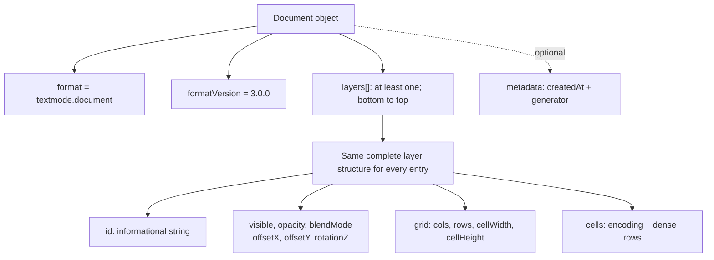
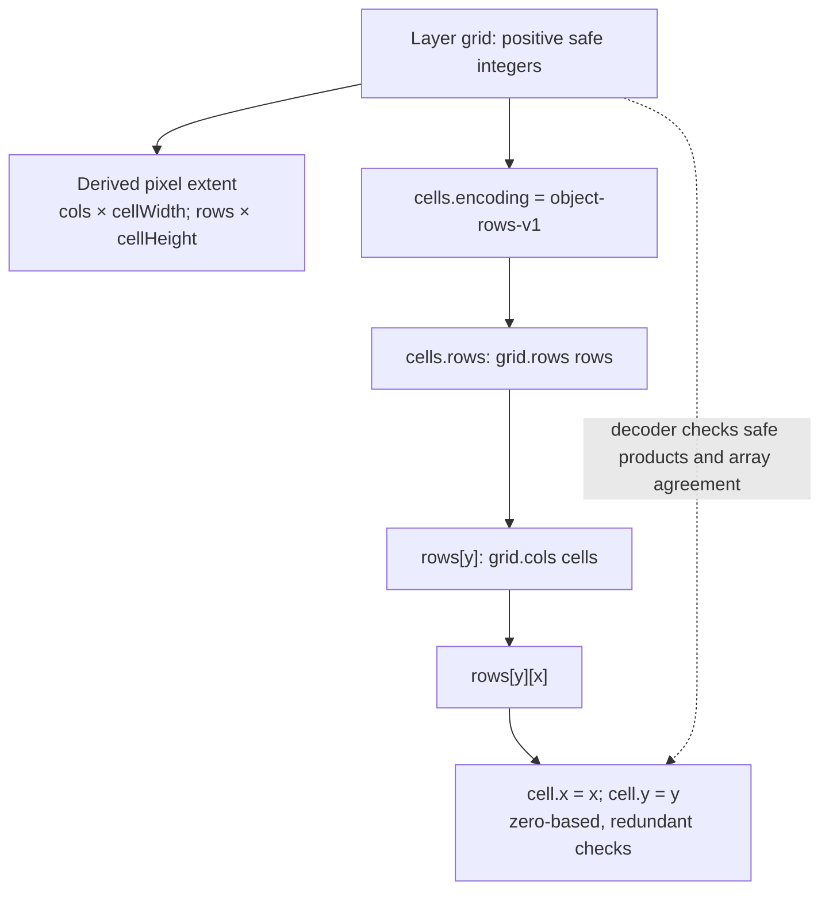
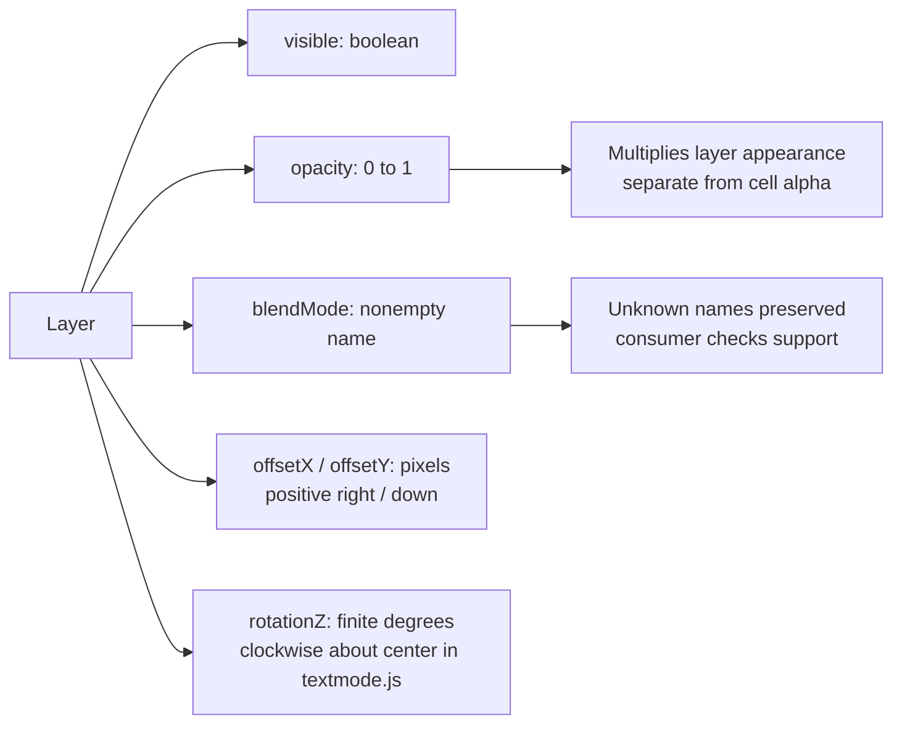
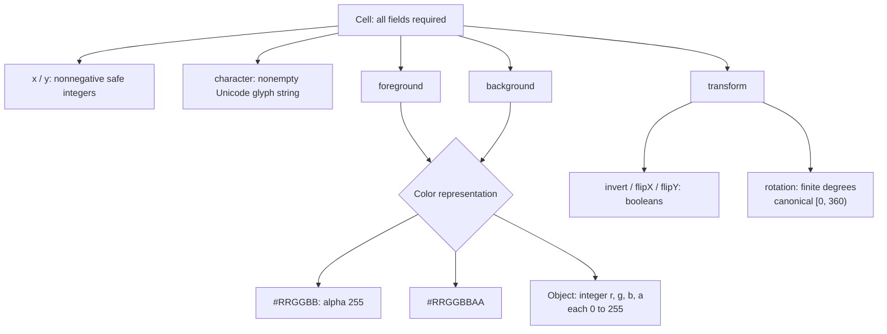
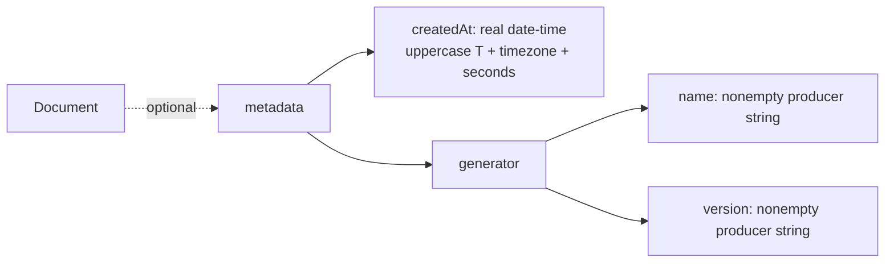
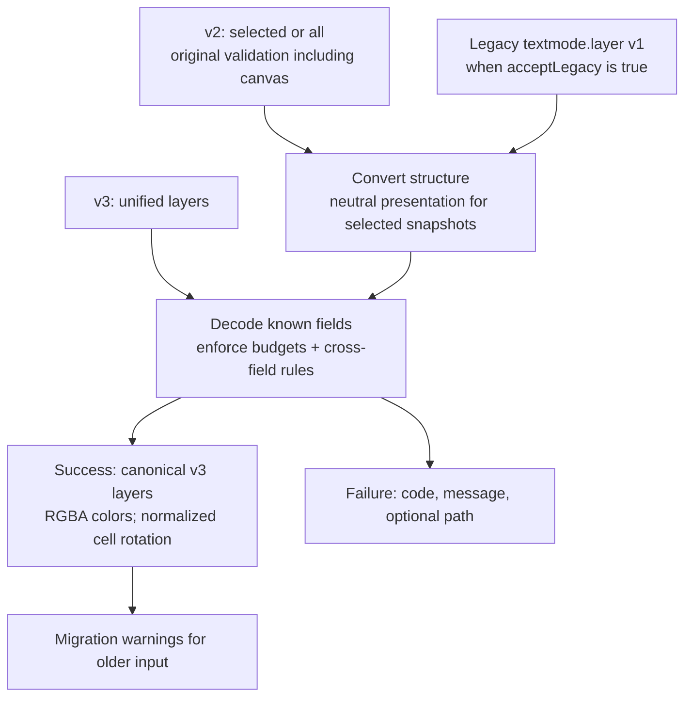

# Visual guide to document format 3.0

These Mermaid diagrams explain the current [JSON Schema](../schemas/3.0/schema.json).
The [specification](specification-3.0.md) defines normative meaning; the
[consumer guide](consumer-guide.md) contains complete documents. The diagrams
are maintained documentation; review them with schema and specification changes.

## One shape for any layer count

All shown members are required except metadata. A one-layer file has one array
entry. There is no root `target`, `layer`, `grid`, or `canvas`; those fields are
rejected. Unknown ordinary fields are accepted and omitted from canonical output.
IDs need not be unique. No font, viewport, or animation is inferred.

## Grids and storage

Every grid position is stored, including fully transparent cells. Layers may
have different dimensions and metrics; there is no root-grid fallback. The
schema describes local shapes; the decoder checks array counts and coordinates.

## Layer presentation

Hidden layers keep their cells. Layer rotation is preserved without canonical
normalization. Stack order is bottom first. Every presentation field is explicit;
JSON Schema defaults are not used to supply missing values.

## Complete cell payload

Canonical colors use RGBA objects. Unicode is preserved without normalization;
unpaired surrogates fail. The schema's minLength/maxLength are 1/64; decoder
scalar-count budgets are configurable. A visible background on a space matters.
Only cells whose foreground and background alpha are both zero are visually
empty. Inversion cannot generally be replaced by swapping colors.

## Metadata

All children are required when metadata is present. Fractional seconds are
optional; leap seconds are unsupported. Enable date-time format assertions in
validators. Metadata is informational and never authorizes code or resource loads.

## Readers and canonical output

The decoder does not require a schema-validator pass. It enforces the shared
rules directly; the specification and schema are independent references. Default
budgets are 16,777,216 cells, 4,096 layers, 1,024 UTF-16 units per ID, 64 scalar
values per glyph, and 4,096 UTF-16 units per metadata string or blend-mode name.
Invalid budgets throw TypeError; malformed data returns a failure. Parsing occurs
before those budgets apply. Apps enforce input-byte limits and supported fonts,
features, and placement. Unknown fields are omitted, so decoding is not an
extension-preserving round trip. See the [v2 visual guide](schema-2.0.md) for
older wire shapes.
