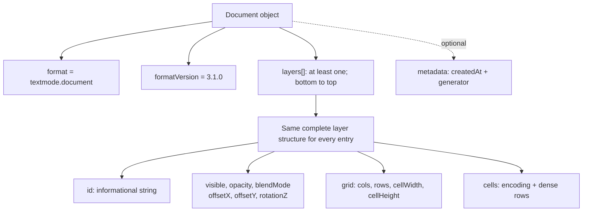
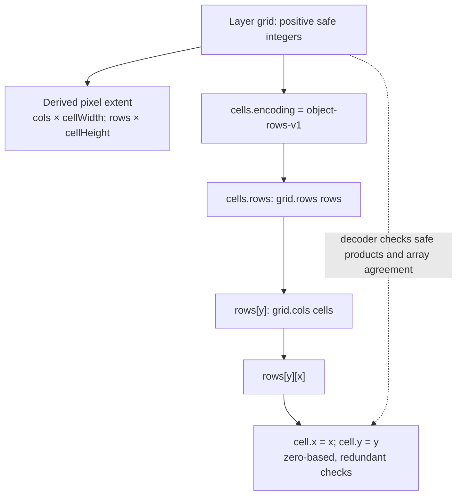
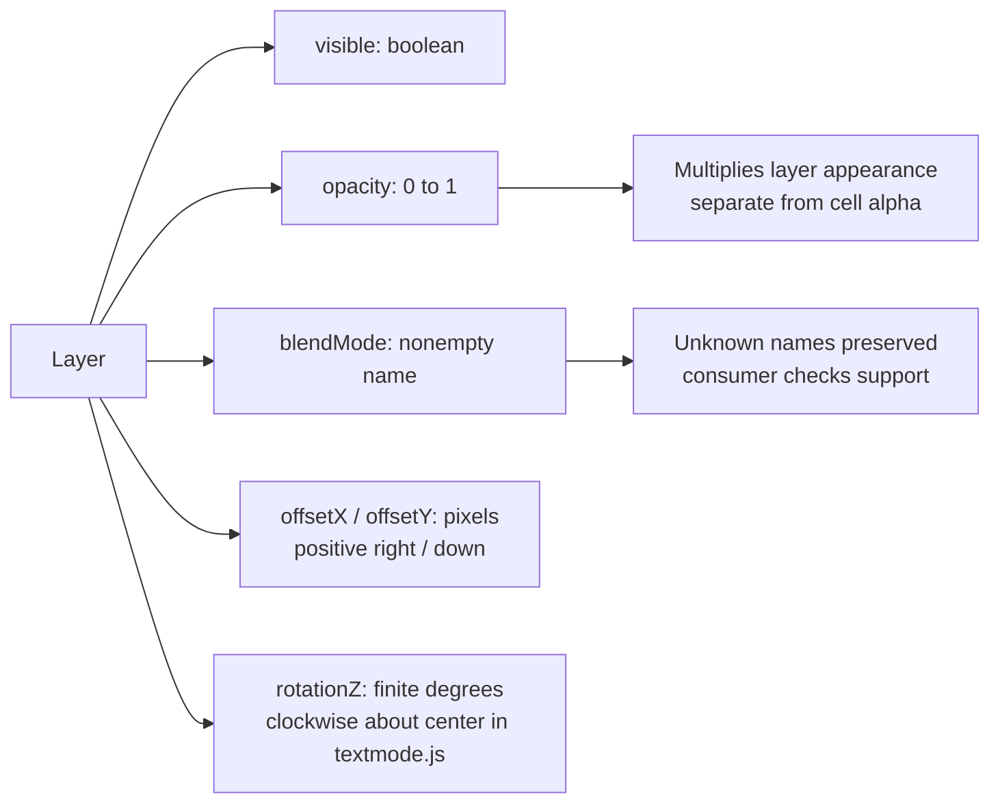
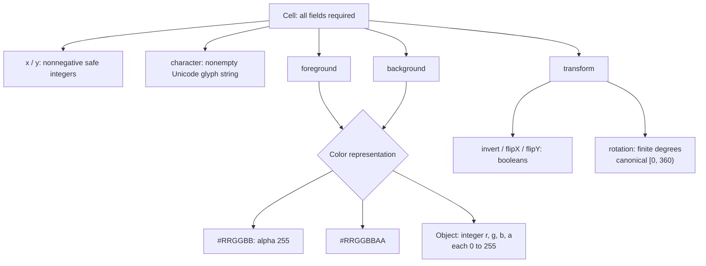
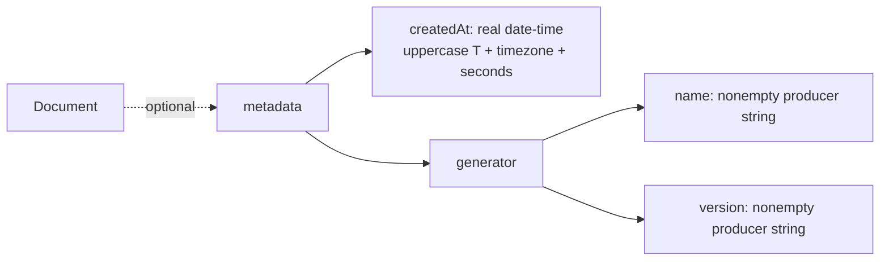
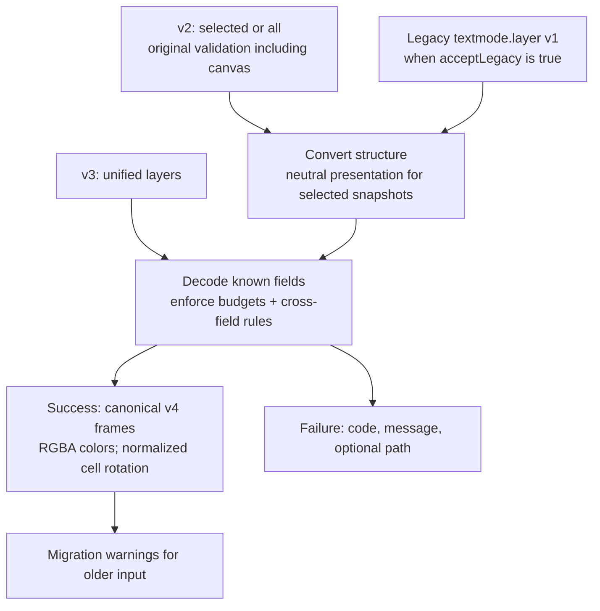
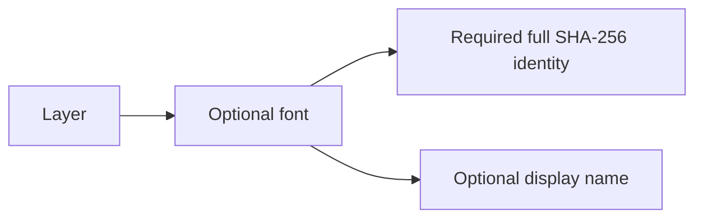

# Visual guide to document format 3.1

This is a historical wire-format reference. The current decoder returns [v4 frames](specification-4.0.md) for every supported input.
These diagrams show the structure of `textmode.document@3.1.0`. For the complete
rules, see the [specification](specification-3.1.md) and [JSON Schema](../schemas/3.1/schema.json).
The [consumer guide](consumer-guide.md) includes complete example documents.

## One shape for any layer count

All shown fields are required except metadata. A document with one layer has one
array entry. Root `target`, `layer`, `grid`, and `canvas` fields are rejected.
Other unknown fields are accepted and omitted from canonical output. IDs need not
be unique. The format does not define a font, viewport, or animation.

## Grids and storage

Every grid position is stored, including transparent cells. Layers can have
different dimensions and cell sizes. The decoder checks row sizes and coordinates
against each layer's grid.

## Layer presentation

Hidden layers keep their cells. Layer rotation is preserved without canonical
normalization. Stack order is bottom first. Every presentation field is explicit;
JSON Schema defaults are not used to supply missing values.

## Complete cell payload

Canonical colors use RGBA objects. Unicode is preserved without normalization;
unpaired surrogates fail. The schema's minLength/maxLength are 1/64; decoder
scalar-count budgets are configurable. A visible background on a space matters.
Only cells whose foreground and background alpha are both zero are visually
empty. Inversion cannot generally be replaced by swapping colors.

## Metadata

All children are required when metadata is present. Fractional seconds are
optional; leap seconds are unsupported. Enable date-time format assertions in
validators. Metadata is informational and never authorizes code or resource loads.

## Readers and canonical output

The decoder checks documents directly; a separate schema validation pass is
optional. It omits unknown fields from canonical output. Applications must check
input size before parsing and apply their own font, feature, and placement rules.
See the [specification](specification-3.1.md#validation-budgets-and-compatibility)
for default limits and the [v2 visual guide](schema-2.0.md) for older shapes.

## Optional font reference

Each layer can include a `font` object. Its `id` is the full normalized SFNT
fingerprint; `name` is optional display text. References never embed a font or
require a local match during decoding. See the
[identity rules](specification-3.1.md#font-identity).

