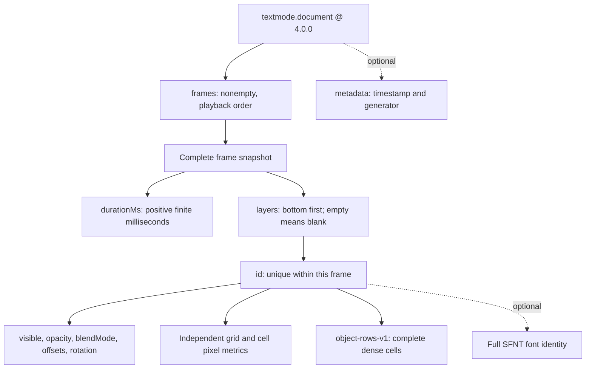
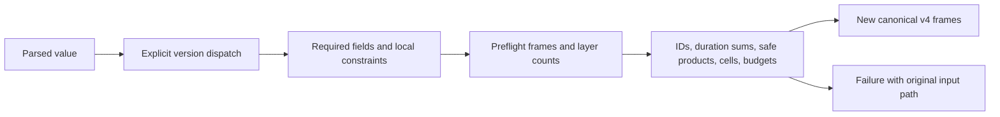
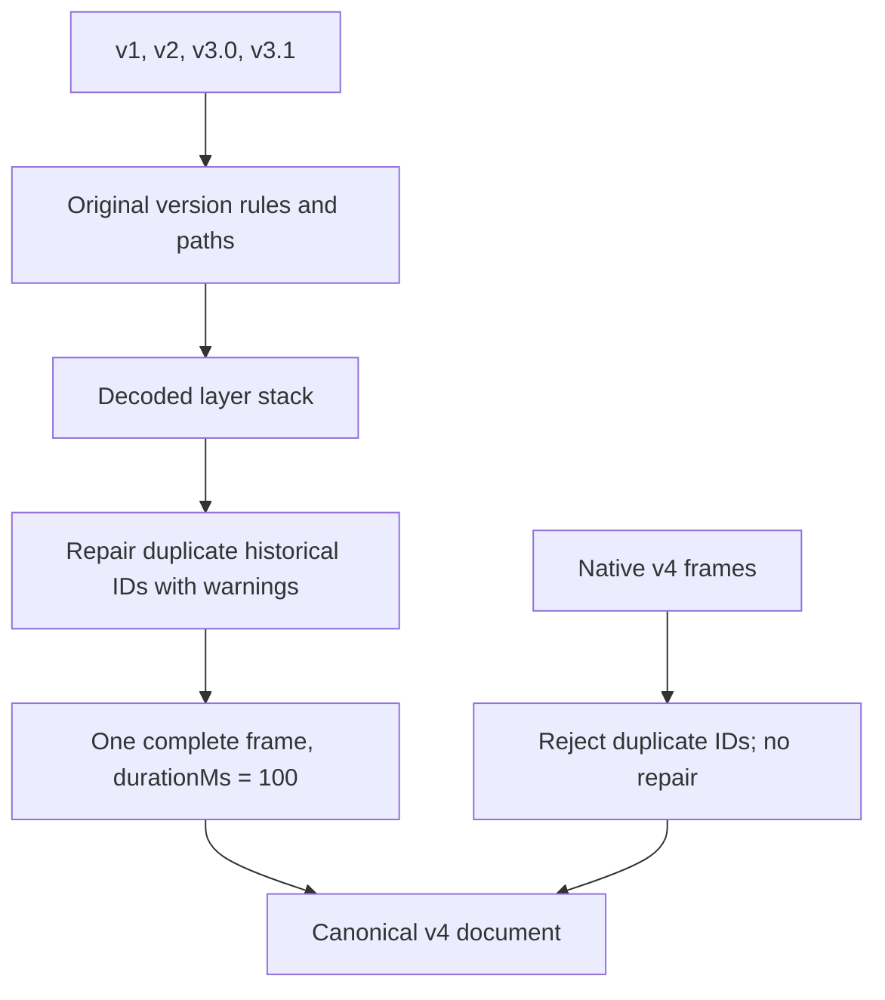

# Visual guide to document format 4.0

See the [specification](specification-4.0.md), [JSON Schema](../schemas/4.0/schema.json),
and [complete examples](consumer-guide.md#complete-still-document).

## Document structure

The same layer ID across frames denotes one logical layer. All values are stored
again in each snapshot. A layer can disappear, return, change position, or change
its grid, font, or presentation. No content is inherited. There is no root canvas.
Wholly blank documents need dimensions from the receiving application or user.

## Validation responsibilities

JSON Schema checks structure and local values. The decoder also checks ID
uniqueness within each frame, grid/row agreement, redundant coordinates,
well-formed Unicode, safe arithmetic, and cumulative budgets. Repeated logical
layers count as separate instances. Empty frames count toward the frame budget.

Canonical colors are RGBA objects. Cell rotation is normalized to [0, 360);
layer rotation and frame durations are preserved. Unknown ordinary properties
are omitted. Root `layers`, `target`, `layer`, `grid`, and `canvas` are rejected.

## Historical inputs

Older schema exports stay unchanged. Migration does not invent font references.
Apps must apply their own font, precision, layout, and feature policies after
decoding. See the [consumer compatibility requirements](specification-4.0.md#consumer-compatibility).
